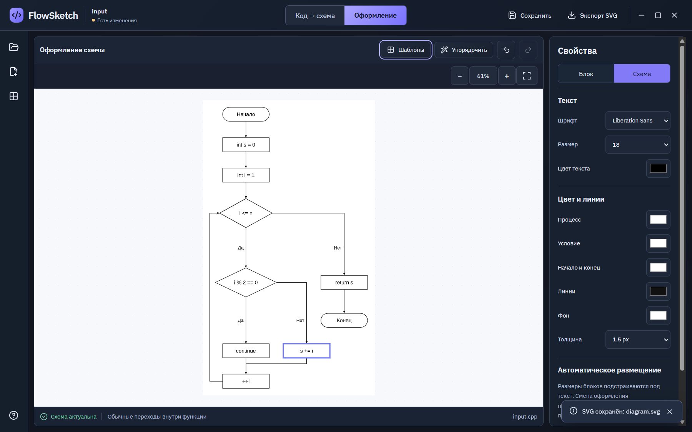
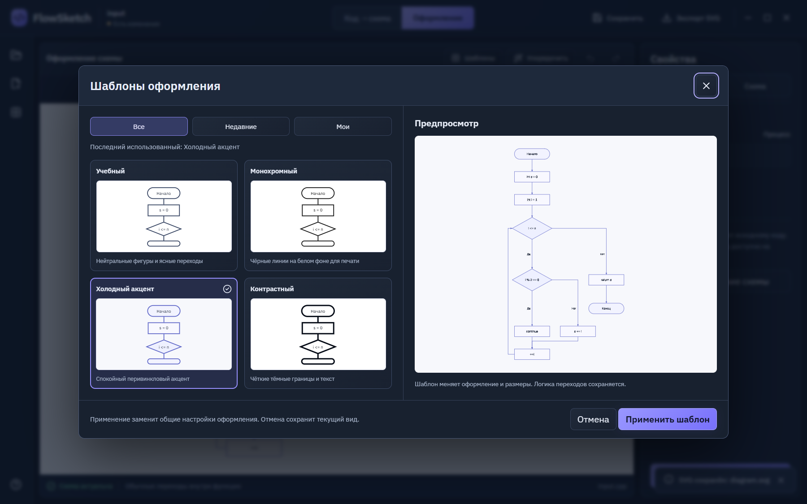

# FlowSketch

**Turn educational C++ functions into readable flowcharts — locally on Windows.**

[](https://github.com/at-flixy/FlowSketch/actions/workflows/ci.yml)
[](LICENSE)
[](ROADMAP.md)

[Русская версия](README.ru.md) · [Build from source](docs/GETTING_STARTED.md) · [Architecture](docs/ARCHITECTURE.md) · [Roadmap](ROADMAP.md) · [Contribute](CONTRIBUTING.md)


FlowSketch is an open-source desktop application built with Tauri, React and a native Clang LibTooling analyzer. Paste a complete C++ function or open a UTF-8 `.cpp` file, select a function, and build a diagram linked to its source. Switch to **Formatting** to choose a theme and adjust typography, colors and layout, then save a project or export SVG.

The interface currently uses Russian labels. The project documentation is available in English and Russian. Contributions and forks are welcome.

## What works today

| Area | Current prototype |
| --- | --- |
| Input | Monaco editor, UTF-8 `.cpp`, function discovery and selection |
| Analysis | Real Clang AST and CFG for the supported scalar C++17 subset; explicit unsupported cases |
| Control flow | `if`, `for`, `while`, `do`, `switch`, `break`, `continue`, `return`; see the native corpus for precise boundaries |
| Diagram | Measured text, ELK layout, orthogonal edges, geometry checks, zoom and pan |
| Source link | Select a block to highlight its source range; source revisions prevent stale exports |
| Formatting | Four built-in themes, custom and recent styles, live preview, Undo/Redo and automatic placement |
| Files | `.flowsketch` projects, backup on save, rebuild after opening, SVG export |
| Desktop host | Windows file dialogs, unsaved-change guard, bounded analyzer protocol, process-tree cancellation |

**This is a working prototype, not completed v1 acceptance.** Parsing a header does not establish semantic support for its library. Educational `cin`/`cout`, arrays, `string`/`vector` profiles, code-fragment wrappers and multiple-file context still need work. Templates, range-based loops, exceptions and RAII control-flow semantics are outside the current supported subset. PNG/PDF are verified experiments, but are not export options in the application yet. Clean-machine installation, offline packaging and full DPI/performance acceptance remain open.

Submitted C++ is parsed; it is never linked or executed to produce a diagram. The current host limits input to 256 KiB / 5,000 lines, graphs to 500 blocks, and analysis to 15 seconds / 1 GiB. These limits and process controls do not constitute a general-purpose security sandbox.

## Start developing

Use **Windows x64**, **Node.js 24.11.1** (the verified version), PowerShell 7, Visual Studio C++ Build Tools with a Windows SDK, CMake and Ninja. Native and Rust toolchains are downloaded into `tools/` with pinned hashes; bootstrap scripts do not modify your permanent PATH.

```powershell
git clone https://github.com/at-flixy/FlowSketch.git
cd FlowSketch
npm ci
pwsh -NoProfile -File scripts/bootstrap-rust.ps1
pwsh -NoProfile -File spikes/clang/bootstrap-toolchain.ps1
pwsh -NoProfile -File scripts/bootstrap-clang-sdk.ps1
pwsh -NoProfile -File scripts/build-analyzer.ps1
npm run desktop:dev
```

The LLVM SDK extraction needs substantial free disk space. See the [complete Windows instructions](docs/GETTING_STARTED.md) before bootstrapping.

For frontend and diagram work without downloading Clang or Rust:

```powershell
npm ci
npm run typecheck
npm test
npm run build
npm run dev
```

The browser preview displays the interface. Native analysis and desktop file operations require Tauri. The diagram tests include 21 versioned real Clang graphs and run without a compiler SDK.

## Design and engineering record

<details>
<summary>Formatting and theme gallery — actual application screenshots</summary>





</details>

- [Full v1 specification, PDF](docs/reference/requirements-v1.pdf), [HTML](docs/reference/requirements-v1.html), [structured JSON](docs/reference/requirements-v1.json). These describe the target, including unfinished requirements.
- [Approved design concepts and prompts](docs/reference/design-brief-and-prompts.txt). Concept images are generated visual references; the screenshots above show the implemented prototype.
- [Stage 1 report](docs/STAGE1_REPORT.md): Clang feasibility, layout and SVG/PNG/PDF experiments.
- [Stage 2 report](docs/STAGE2_REPORT.md): native analyzer, Rust host and real Windows/WebView2 verification.
- [Evidence provenance](docs/PUBLICATION.md): historical measurements, path normalization and public source boundaries.

The stage 2 developer-machine runs recorded **47/47 native cases**, **12/12 Rust host tests**, **12/12 scene tests**, and **16/16 real-window end-to-end checks**. These are dated evidence, not a claim that every environment or every C++ program works. GitHub CI separately checks the public checkout; it does not run the interactive Windows acceptance suite.

## Repository map

```text
src/                React UI, Monaco and shared diagram scene
src-tauri/          Rust desktop host and Windows process controls
native/analyzer/    Clang LibTooling sidecar, protocol and native tests
tests/fixtures/     Versioned graph snapshots for SDK-free regression tests
spikes/             Reproducible feasibility experiments and evidence
scripts/            Toolchain bootstrap, build and verification commands
docs/               Specification, design, reports and dependency notices
```

Build outputs, downloaded SDKs and editor caches are excluded from Git. The previous local binary archive is not a public release: source-availability and notice completeness still need release work. You can build the prototype from this repository now.

## Open source

Our original code, tests, documentation and project artwork are licensed under [MIT](LICENSE): you can use, modify, fork and redistribute them, including commercially, while retaining the required notices. Fonts, libraries and copied upstream materials keep their own licenses; see [THIRD_PARTY_NOTICES.md](THIRD_PARTY_NOTICES.md).

To propose a change, read [CONTRIBUTING.md](CONTRIBUTING.md), choose a task from [ROADMAP.md](ROADMAP.md), and open an issue or pull request. Correct control flow and explicit unsupported cases take priority over a diagram that only looks plausible.
