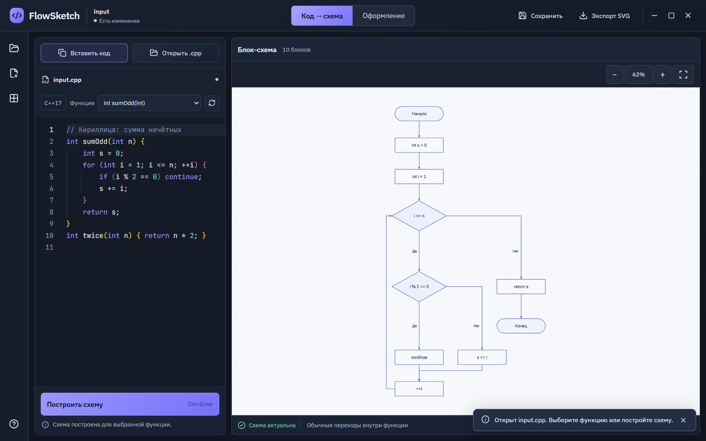

# FlowSketch

**Учебные функции C++ → читаемые блок-схемы в локальном приложении Windows.**

[English](README.md) · [Сборка](docs/GETTING_STARTED.md) · [Архитектура](docs/ARCHITECTURE.md) · [План работ](ROADMAP.md) · [Участие](CONTRIBUTING.md)



Приложение на Tauri, React и Clang LibTooling. Вставьте законченную функцию C++ или откройте UTF-8 `.cpp`, выберите функцию и постройте схему. Выбор блока выделяет соответствующий код. В режиме «Оформление» доступны четыре шаблона, свои и недавние стили, цвета, размеры текста и линий, предпросмотр и Undo/Redo. Проекты сохраняются в `.flowsketch`, актуальная схема экспортируется в SVG.

Это **первый рабочий прототип**. ТЗ первой версии ещё не выполнено целиком. Сейчас анализируются обычные переходы поддержанного скалярного подмножества C++17: условия, циклы, `switch`, `break`, `continue`, `return`. Профили учебного ввода/вывода, массивов, `string`/`vector`, обёртки фрагментов и многофайловый контекст предстоит добавить. Успешный разбор заголовка не означает поддержку всей семантики библиотеки. Исключения, RAII и другие неподдержанные конструкции получают явную диагностику. PNG/PDF проверены в экспериментах, но пока отсутствуют в меню экспорта приложения.

Исходный C++ не запускается. Разбор ограничен 256 KiB / 5000 строками, 500 блоками, 15 секундами и 1 GiB памяти. На машине разработки проверены 47/47 native cases, 12/12 Rust tests, 12/12 scene tests и 16/16 настоящих Windows/WebView2 E2E. Офлайн-установщик на чистой Windows, вся матрица ТЗ, DPI и требования производительности ещё требуют приёмки.

## Сборка

Нужны Windows x64, Node.js 24.11.1, PowerShell 7, Visual Studio C++ Build Tools с Windows SDK, CMake и Ninja. Локальные toolchains устанавливаются в `tools/` без изменения постоянного PATH. Перед загрузкой LLVM проверьте свободное место по [инструкции сборки](docs/GETTING_STARTED.md).

```powershell
git clone https://github.com/at-flixy/FlowSketch.git
cd FlowSketch
npm ci
pwsh -NoProfile -File scripts/bootstrap-rust.ps1
pwsh -NoProfile -File spikes/clang/bootstrap-toolchain.ps1
pwsh -NoProfile -File scripts/bootstrap-clang-sdk.ps1
pwsh -NoProfile -File scripts/build-analyzer.ps1
npm run desktop:dev
```

Проверки сцены не требуют Clang/Rust: `npm ci`, `npm run typecheck`, `npm test`, `npm run build`. `npm run dev` открывает браузерный интерфейс; реальный анализ и файловые операции требуют Tauri.

## Документы и дальнейшая работа

- [ТЗ PDF](docs/reference/requirements-v1.pdf), [HTML](docs/reference/requirements-v1.html), [JSON](docs/reference/requirements-v1.json).
- [Принятые макеты и описание дизайна](docs/reference/design-brief-and-prompts.txt).
- [Отчёт этапа 1](docs/STAGE1_REPORT.md) и [отчёт этапа 2](docs/STAGE2_REPORT.md).
- [Общий план с постоянными ID задач](ROADMAP.md). Он хранится в Git и доступен всем участникам и чатам.
- [Как внести изменения](CONTRIBUTING.md) и [происхождение свидетельств](docs/PUBLICATION.md).

Исходники открыты под **MIT**: можно использовать, менять, создавать форки и распространять проект, сохраняя необходимые уведомления. Зависимости и шрифты сохраняют свои лицензии: [LICENSE](LICENSE), [THIRD_PARTY_NOTICES.md](THIRD_PARTY_NOTICES.md).

Текущий публичный выпуск содержит исходники, ТЗ, дизайн и свидетельства проверок. Готовый бинарный release появится после завершения проверки состава лицензий и поставки. SDK, временные сборки и caches не входят в Git.
