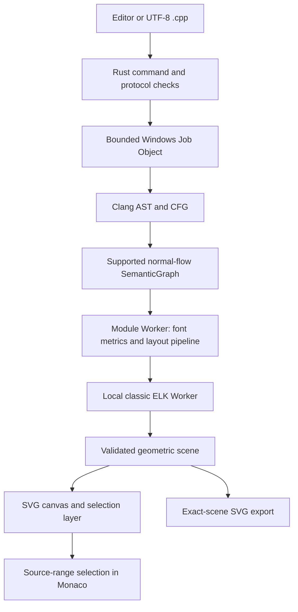

# FlowSketch architecture

FlowSketch separates C++ meaning from diagram appearance. Clang produces a
bounded semantic graph; a browser Worker measures and lays out that graph; the
canvas and SVG export consume one geometric scene. Changing a color or font
size never adds, removes or redirects a semantic transition.

## Components

| Location | Responsibility |
| --- | --- |
| `src/App.tsx`, `src/components`, `src/styles.css` | React interface, Monaco editor, two modes, diagnostics, selection, project state and revision guards. |
| `src/types.ts` | Shared frontend contracts for functions, semantic graphs, styles, projects and analyzer responses. |
| `src/diagram` | Local font metrics/outlines, ELK layout, geometry validation, canvas interaction and exact-scene export. |
| `src-tauri` | Rust commands, native file dialogs, project persistence, protocol validation and Windows process limits. |
| `native/analyzer` | C++ Clang LibTooling sidecar: function discovery, AST/CFG extraction and mapping of supported normal-flow constructs. |
| `scripts` | Pinned tooling setup, builds, tests, notices and prototype packaging. |
| `spikes` | Earlier experiments, independent expectations and runtime evidence; Node-only experiments are not browser modules. |

## Source analysis and native process boundary

The ordinary application invokes a fixed native analyzer executable with fixed
arguments. Source text travels through a versioned JSON request on stdin.
Clang parses the source and builds a compiler CFG; the mapper translates the
supported source constructs into an explicit normal-flow abstraction. It does
not compile the submitted source into an executable, link it or run it.

The host starts the analyzer suspended, assigns it to a Windows Job Object,
then resumes it. Current limits include 256 KiB / 5,000 source lines, 15 seconds,
1 GiB job memory and 16 MiB stdout. Process I/O is bounded; cancellation and
failure terminate the job tree. The graph contract allows at most 500 nodes and
1,000 edges. Limits are implemented in the Rust protocol/process modules and
the analyzer, not merely displayed in the interface.

Requests carry a request ID, source revision, source digest and fixed compile
context digest. Responses must echo the matching protocol and identities.
The host validates response structure, statuses and graph references before
the interface accepts the result. A cancelled, stale or failed result cannot
be treated as a newly built diagram.

The current compile context is a pinned Windows x64 C++17 educational profile.
Complete local header roots are shipped with the prototype; an installed SDK
or arbitrary external include paths are not its compile context. Successful
parsing of a standard header does not imply that its library operations have
complete diagram semantics.

## Semantic graph and source mapping

Nodes have stable IDs, a figure kind, a label and optional source range/original
text. Edges retain their source, target, semantic role and optional label.
Function discovery and analysis return explicit statuses such as
`BUILT_NORMAL_FLOW`, `BUILT_WITH_ABSTRACTION`, `UNSUPPORTED`, `CONTEXT_REQUIRED`
or `INPUT_ERROR`.

`role: 'back'` or `layoutHint: 'back'` identifies a feedback edge for layout.
The hint is independent of semantics: a while-loop `continue` can be feedback,
whereas a for-loop `continue` to its increment or a do-while `continue` to its
bottom condition is forward. The layout excludes feedback edges only when
establishing a forward rank order; all transitions remain in routing and export.
An unexplained cycle in that forward graph produces an explicit layout error.

Clang offsets refer to UTF-8 bytes. Monaco positions use UTF-16 columns. The
frontend converts the source ranges against the current source snapshot;
synthetic start/end nodes have explicit provenance rather than invented source
locations. This distinction matters for Cyrillic text and characters outside
the basic multilingual plane.

## Geometric scene and local workers

The main window loads immutable local font and ELK asset bytes. The module
Worker decodes the supplied Liberation Sans TTF with fontkit, measures/wraps
text and obtains glyph outlines. It sizes real flowchart shapes, including the
inscribed text area of decision diamonds, then calls ELK with fixed ports,
orthogonal routing and deterministic model order.

ELK's GWT engine runs in a separate classic Worker. The parent window creates
a Blob URL from the locally packaged ELK script and passes that URL to the
module Worker. This avoids the packaged Windows WebView2 nested-worker custom
protocol issue tracked in [Tauri #15755](https://github.com/tauri-apps/tauri/issues/15755).
It uses the existing `worker-src 'self' blob:` policy without allowing eval or
remote scripts. Normal completion, failure, cancellation and timeout terminate
the outer Worker and revoke its owned Blob URL. Nested worker load/message/CSP
failures have explicit diagnostics.

The scene contains node polygons, glyph ink bounds, edge routes, label boxes
and vector primitives. Geometry validation checks text containment, detached
ports, node overlap, unrelated-shape intersections, label placement, orthogonal
segments and forward flow direction. A rejected scene cannot be exported.
Validation is a set of explicit invariants, not a promise that every arbitrary
graph can be laid out successfully or compactly.

`graphDigest`, `styleDigest`, `sceneDigest`, model/style revisions and request ID
identify the result. Transport IDs and timings are excluded from the geometry
fingerprint. An older Worker is terminated when its controller receives a new
request. Independent gallery previews use their own controllers.

## Canvas, appearance, exports and persistence

The canvas draws the scene primitives and an independent interaction layer for
selection, keyboard focus, zoom and pan. Export omits that interaction layer,
the grid and the viewport. SVG uses the same glyph paths and shapes rather than
system fonts or screenshots. Unicode labels, source ranges, transition roles,
font hash and revisions are preserved in metadata.

Four style presets and bounded custom colors/font size/stroke width are
supported. A font-size change remeasures the text and rebuilds the geometry;
it does not scale stale node bounds. The shipped family is Liberation Sans.
The browser module can rasterize this SVG to PNG with explicit dimension/pixel
caps, while the ordinary desktop prototype currently exposes SVG export only.
The earlier Node PDF experiment is separate from the browser/Tauri pipeline.

A `.flowsketch` project stores versioned source, selected function and style,
not a trusted previously rendered scene. The Rust file layer validates its
schema, writes through a temporary file and retains a backup. Opening a project
requires rebuilding the graph. Editor changes make a shown diagram stale and
disable export until the current revisions have a ready scene.

## Packaging and verification boundaries

The prototype folder contains an ordinary Tauri executable, the fixed analyzer,
two complete pinned header roots, notices and a per-file manifest. Full LLVM
SDK libraries, Node, Rust and the Clang compiler executable are build tools,
not application runtime dependencies. WebView2 remains a runtime prerequisite.
The optional `webdriver` feature, test API and automated fixture path chooser
are excluded from the ordinary build.

Versioned graph fixtures test the scene without bootstrapping Clang. Native
corpus tests exercise the actual analyzer. Rust tests exercise protocol and
Windows Job Object behavior. The documented desktop E2E additionally verifies
real IPC, workers at `tauri.localhost`, editor linkage, stale revisions and
file operations. A development-server browser result alone cannot verify the
embedded-origin worker path.

Current scope is an educational scalar-function slice. Arbitrary C++17,
multi-file build contexts, macro/RAII/class/exception semantics, complete
string/vector/iostream profiles, unrestricted graph layout, compact 200-node
scenes, desktop PNG/PDF, full DPI coverage and clean offline installation are
not claimed. Read [STAGE2_REPORT.md](STAGE2_REPORT.md) for the recorded evidence
and [GETTING_STARTED.md](GETTING_STARTED.md) for reproducible build commands.
